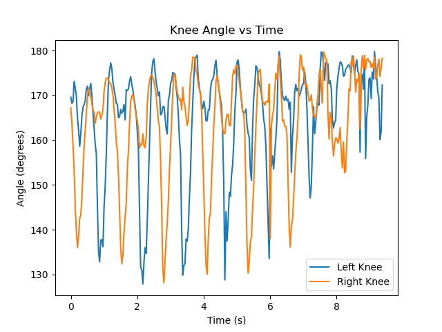

# PoseGait: Interpretable Gait Feature Analysis

PoseGait is a computer-vision project that estimates lower-body pose from a walking video and converts the detected motion into readable gait features. It is designed as a transparent feature-extraction demo, not as a gait-recognition product or a medical assessment.

## At a glance

- **Input:** a walking video readable by OpenCV.
- **Pose estimation:** MediaPipe Pose, using its legacy `Solutions` API.
- **Features:** hip and knee angles, a simple step-interval estimate, cadence, and ankle displacement.
- **Outputs:** landmark and feature CSV files, a summary CSV, a knee-angle plot, and optionally a skeleton-overlay video.

## Example results

Running the included `sample_data/walking_video.mp4` through the current script produced the following example summary:

| Feature | Example result |
| --- | ---: |
| Mean left knee angle | 163.39° |
| Left knee angle variance | 150.60°² |
| Mean right knee angle | 162.96° |
| Right knee angle variance | 149.42°² |
| Mean hip angle | 69.31° |
| Mean step interval | 0.576 s |
| Estimated cadence | 104.11 steps/min |
| Mean left-ankle vertical displacement per frame | 0.0043 (normalized image coordinates) |

These are example outputs from one run, not reference values or validated clinical measurements. Results can vary with the video, camera angle, frame rate, landmark confidence, and software or hardware.

An example knee-angle plot is included:



## How it works

1. Open the video and read it frame by frame.
2. Estimate MediaPipe pose landmarks and retain the left and right hips, knees, and ankles.
3. Ignore low-visibility coordinates and calculate joint angles from the 2D landmark positions.
4. Smooth the left-ankle vertical signal and estimate step intervals from its peaks.
5. Save frame-level data, summary statistics, the plot, and optionally a skeleton-overlay video.

The cadence is derived from the average detected interval between peaks in one ankle signal. It is a simple heuristic and can miss steps or report misleading values when the subject is occluded or the camera view is unsuitable.

## Requirements

- Windows, macOS, or Linux
- Python 3.10 or 3.11 recommended
- A video file supported by your OpenCV installation

The script depends on MediaPipe's legacy `mp.solutions.pose` interface. The project requirements pin a compatible MediaPipe release. Use the project's isolated `.venv` rather than installing these packages into a shared environment: other packages such as TensorFlow 2.20 can require incompatible protobuf versions.

## Setup

Run these commands from the project directory.

### Windows PowerShell

```powershell
py -3.11 -m venv .venv
.\.venv\Scripts\python.exe -m pip install --upgrade pip
.\.venv\Scripts\python.exe -m pip install -r requirements.txt
```

### macOS or Linux

```bash
python3.11 -m venv .venv
./.venv/bin/python -m pip install --upgrade pip
./.venv/bin/python -m pip install -r requirements.txt
```

You can activate the environment if preferred, but calling its Python executable directly (as shown below) avoids accidentally using a different interpreter.

## Run

From the project directory:

### Windows PowerShell

```powershell
& ".\.venv\Scripts\python.exe" ".\gait_features.py" ".\sample_data\walking_video.mp4" --output-dir ".\outputs"
```

### macOS or Linux

```bash
./.venv/bin/python gait_features.py sample_data/walking_video.mp4 --output-dir outputs
```

To skip writing the overlay video:

```powershell
& ".\.venv\Scripts\python.exe" ".\gait_features.py" ".\sample_data\walking_video.mp4" --output-dir ".\outputs" --no-overlay
```

For your own video, replace the sample-video path with its path. Use `--help` to see the available command-line options.

## Results created

The output directory contains:

| File | Contents |
| --- | --- |
| `keypoints.csv` | Per-frame normalized coordinates and visibility for six lower-body landmarks. |
| `frame_level_features.csv` | Landmark data plus per-frame left-knee, right-knee, and hip angles. |
| `gait_feature_summary.csv` | The aggregate feature values shown in the terminal. |
| `knee_angles.png` | Plot of left and right knee angles over time. |
| `skeleton_overlay.mp4` | Input video with pose landmarks drawn on detected poses; omitted with `--no-overlay`. |

The script creates the output directory if it does not already exist. Running it again with the same output directory replaces files with the same names.

## Troubleshooting

### `mp.solutions` is missing

This usually means the script is running under a Python environment with a newer, incompatible MediaPipe package. Run it with the project environment's Python:

```powershell
& ".\.venv\Scripts\python.exe" ".\gait_features.py" ".\sample_data\walking_video.mp4"
```

In VS Code, use **Python: Select Interpreter** and select the project's `.venv` interpreter (`.venv\Scripts\python.exe` on Windows). If `.venv` has not been created, follow [Setup](#setup).

### TensorFlow oneDNN informational message

A line such as `oneDNN custom operations are on` is an informational startup message, not the cause of the missing `mp.solutions` error. The script does not need TensorFlow to process the video; use the isolated project environment to avoid conflicts with packages in a shared environment.

### Video cannot be opened

Check that the path is correct, that the video file is accessible, and that OpenCV can decode its format. The script reports an error if it cannot open the input or the video does not provide a valid frame rate.

## Project files

```text
pose-gait-feature-lab/
├── gait_features.py
├── requirements.txt
├── README.md
├── sample_data/
│   └── walking_video.mp4
└── outputs/
    ├── example_feature_vector.txt
    ├── example_keypoints.csv
    ├── example_knee_angles.png
    └── demo_skeleton_overlay.mp4
```

The files prefixed with `example_` and the demo overlay are included example artifacts; running the script generates the current output files listed above. Before redistributing the sample clip or demo overlay, confirm that you have permission to share the video and the person depicted in it.

## Limitations

- Features are calculated from 2D image coordinates, not calibrated 3D motion.
- Camera position, occlusion, visibility, frame rate, and pose-estimation quality affect the results.
- Step timing uses one ankle signal and a basic peak-detection heuristic.
- This project processes a clip but does not train or evaluate a gait-recognition model.
- Do not use these estimates for diagnosis or medical decisions.

## Technologies

Python, MediaPipe, OpenCV, NumPy, Pandas, SciPy, and Matplotlib.
